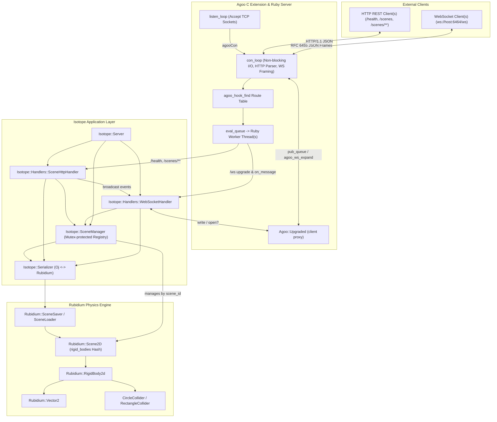
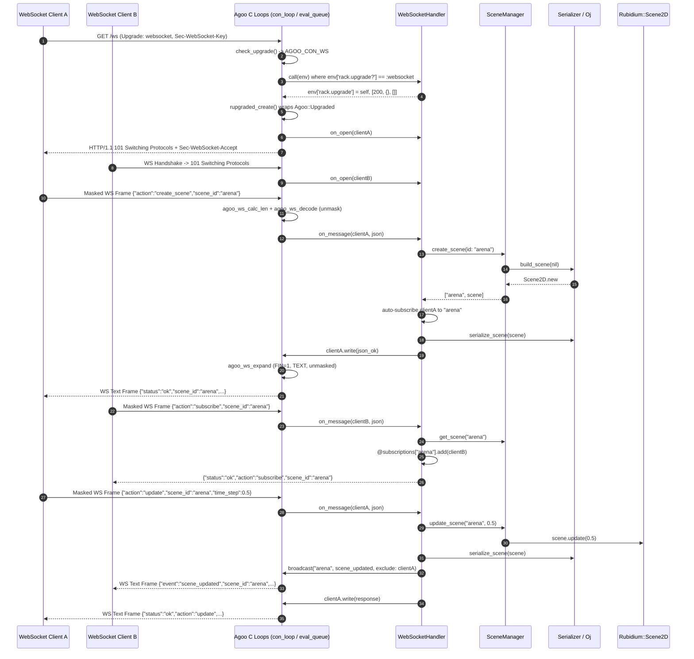
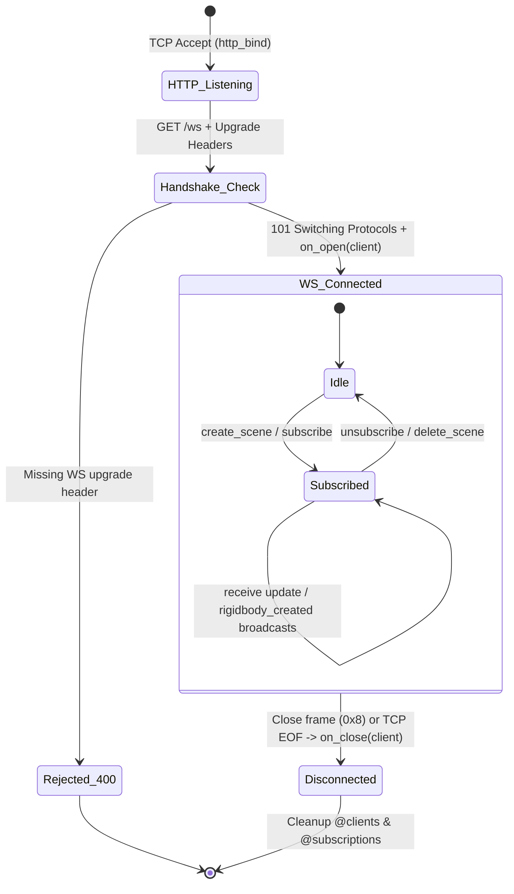

# Isotope Architecture & UML Diagrams

This document describes the architecture of **Isotope**, its integration with the **Agoo** HTTP/WebSocket server, **Oj** JSON parser/serializer, and the **Rubidium** 2D physics engine (`Rubidium::Scene2D`).

---

## 1. System Architecture Overview

---

## 2. Complete UML Class Diagram

```mermaid
classDiagram
    direction TB

    namespace Isotope {
        class Server {
            +Integer port
            +String root
            +SceneManager scene_manager
            +WebSocketHandler ws_handler
            +SceneHttpHandler http_handler
            -Integer thread_count
            -Boolean log_console
            -Boolean started
            +initialize(port, root, thread_count, scene_manager, log_console)
            +start() Server
            +stop() void
            +started?() Boolean
            -register_routes() void
        }

        class SceneManager {
            +DEFAULT_TIME_STEP : Float
            -Hash~id, Rubidium::Scene2D~ scenes
            -Integer next_id
            -Mutex mutex
            +normalize_id(id) Integer|String
            +create_scene(id, scene_data) Array
            +get_scene(scene_id) Rubidium::Scene2D
            +scene?(scene_id) Boolean
            +delete_scene(scene_id) Rubidium::Scene2D
            +list_scenes() Hash
            +scene_ids() Array
            +clear() void
            +create_rigidbody(scene_id, body_data) Array
            +get_rigidbody(scene_id, body_id) Array
            +remove_rigidbody(scene_id, body_id) Rubidium::RigidBody2d
            +add_linear_force(scene_id, body_id, force_data) Rubidium::RigidBody2d
            +update_scene(scene_id, time_step) Rubidium::Scene2D
            +update_all(time_step) Hash
            +save_scene(scene_id, file_path) String
            +load_scene(scene_id, file_path) Array
            +serialize(scene_id) Hash
        }

        class Serializer {
            <<module>>
            +serialize_scene(scene)$ Hash
            +serialize_rigidbody(body, id)$ Hash
            +build_scene(data)$ Rubidium::Scene2D
            +build_rigidbody(data)$ Rubidium::RigidBody2d
            +build_vector2(data)$ Rubidium::Vector2
        }

        class SceneNotFoundError {
            <<KeyError>>
        }

        class RigidBodyNotFoundError {
            <<KeyError>>
        }
    }

    namespace Isotope_Handlers {
        class WebSocketHandler {
            -SceneManager scene_manager
            -Set~Agoo::Upgraded~ clients
            -Hash~id, Set~Agoo::Upgraded~~ subscriptions
            -Mutex mutex
            +initialize(scene_manager)
            +call(env) Array
            +on_open(client) void
            +on_close(client) void
            +on_message(client, raw_data) void
            +broadcast(scene_id, payload, exclude) void
            +client_count() Integer
            +clear_scene_subscriptions(scene_id) void
            -dispatch_action(client, action, msg) Hash
        }

        class SceneHttpHandler {
            +JSON_HEADERS : Hash
            -SceneManager scene_manager
            -WebSocketHandler ws_handler
            +initialize(scene_manager, ws_handler)
            +call(env) Array
            -route(method, path, env) Array
            -parse_json_body(env) Hash
            -json_response(status, payload) Array
        }
    }

    namespace Agoo {
        class AgooServer["Agoo::Server"] {
            <<C extension>>
            +init(port, root, options)$
            +handle(method, pattern, handler)$
            +start()$
            +shutdown()$
        }

        class Upgraded["Agoo::Upgraded"] {
            <<C extension proxy>>
            +write(msg) Boolean
            +open?() Boolean
            +close() void
            +pending() Integer
            +protocol() Symbol
            +subscribe(subject) void
            +unsubscribe(subject) void
            +env() Hash
        }
    }

    namespace Rubidium {
        class Scene2D {
            +Hash~Integer, RigidBody2d~ rigid_bodies
            -Integer next_id
            +load(file_path)$ Scene2D
            +initialize(rigid_bodies)
            +create_rigidbody(rigid_body) Integer
            +get_rigidbody(id) RigidBody2d
            +load(file_path) Scene2D
            +save(file_path) void
            +update(time_step) void
        }

        class RigidBody2d {
            +Float mass
            +Vector2 position
            +Vector2 velocity
            +Vector2 acceleration
            +Float rotation
            +Float angular_velocity
            +Float angular_acceleration
            +Float drag
            +Boolean static
            +Collider collider
            +update(time_step) void
            +add_linear_force(force) void
            +narrow_collision_check(other) Boolean
            +get_collided_objects(spatial_hashmap) Array
        }

        class Vector2 {
            +Numeric x
            +Numeric y
            +add(other) void
            +subtract(other) void
            +multiply_with_scalar(scalar) void
        }

        class Collider {
            <<abstract>>
        }

        class CircleCollider {
            +Numeric radius
        }

        class RectangleCollider {
            +Numeric width
            +Numeric height
        }

        class SceneSaver {
            +save(scene, file_path)$ void
            +to_json(scene)$ String
        }

        class SceneLoader {
            +load(file_path)$ Scene2D
            +from_json(json_string)$ Scene2D
        }
    }

    Server *-- SceneManager : owns
    Server *-- WebSocketHandler : owns
    Server *-- SceneHttpHandler : owns
    Server ..> AgooServer : configures and runs

    WebSocketHandler --> SceneManager : dispatches actions
    WebSocketHandler ..> Serializer : serializes payloads
    WebSocketHandler o-- Upgraded : tracks clients and subscriptions

    SceneHttpHandler --> SceneManager : dispatches REST ops
    SceneHttpHandler o-- WebSocketHandler : optional broadcasts
    SceneHttpHandler ..> Serializer : serializes payloads

    SceneManager *-- "0..*" Scene2D : manages by scene_id
    SceneManager ..> Serializer : builds objects
    SceneManager ..> SceneNotFoundError : raises
    SceneManager ..> RigidBodyNotFoundError : raises

    Serializer ..> SceneSaver : serializes via Oj
    Serializer ..> SceneLoader : deserializes via Oj
    Serializer ..> Vector2 : builds

    Scene2D *-- "0..*" RigidBody2d : rigid_bodies
    RigidBody2d *-- Vector2 : position / velocity / acceleration
    RigidBody2d o-- "0..1" Collider : collider
    Collider <|-- CircleCollider
    Collider <|-- RectangleCollider
```

---

## 3. Agoo WebSocket Lifecycle & Scene Data Flow

---

## 4. Connection & Subscription State Machine

